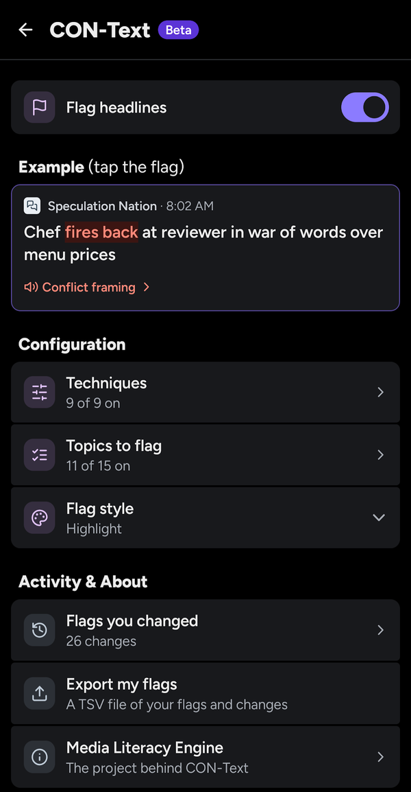
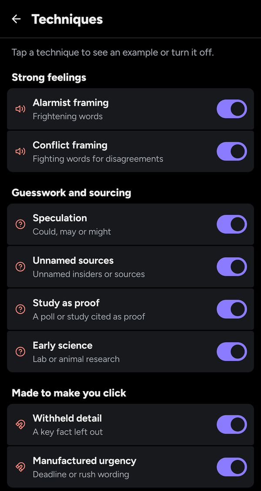
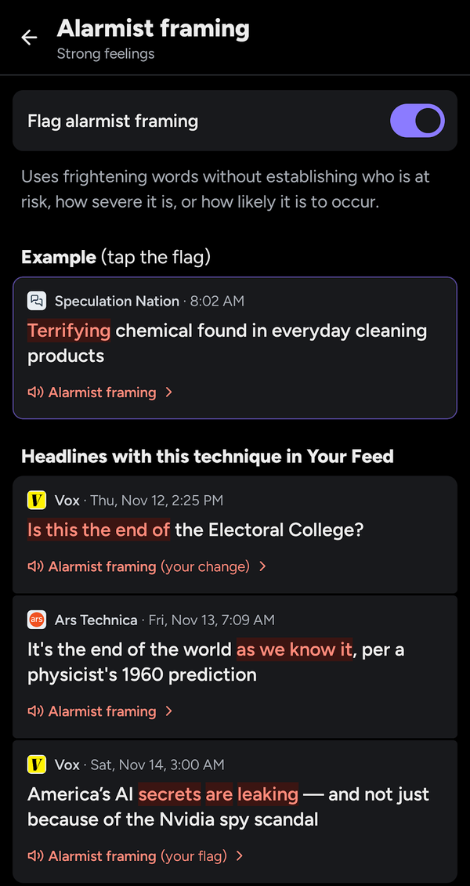

# Media Literacy Engine (MLE)

[](https://kotlinlang.org)
[](LICENSE)


MLE reads a news headline and points at the words that are working on you. It names the technique, marks the exact characters, and gives the reader one question to ask before they click.

```
These 3 Tech Stocks Could Be Poised To Surge Next Week
^^^^^^^^^^^^^^^^^^^          ^^^^^^^^^^^^^^^
Withheld detail              Speculation
"Which things is it          "Has this actually happened,
talking about, and does      or might it happen?"
the headline name them?"
```

It is a Kotlin library made of fixed rules. There is no model inside it, it makes no network calls, and the same headline always gets the same answer, so every flag can be traced to the rule that produced it.

MLE is a research and educational project. It tries to make a handful of headline techniques easy to name and easy to question, and it is open so that people can test the rules, challenge them and improve them. It is a ruleset, and you can use it however suits you. If you would like to help, start with [Ways to contribute](#ways-to-contribute).

## What it is for

MLE is a teaching tool. It is meant to help a reader notice a technique often enough that they start to spot it without help. That goal sets a few limits, and they are worth knowing before you rely on it.

It speaks only when the case is clear. A wrong flag on an honest headline teaches the wrong lesson, and a missed headline costs a reader very little, so when a headline is borderline MLE stays quiet. It catches well under half of the clickbait it sees, on purpose. If you need a filter that catches most of it, this is the wrong tool.

It does not check facts. A flag means "this technique is in the wording". It does not mean the story is false or that anyone acted in bad faith. Careful outlets use these techniques too.

It never judges the publisher. No outlet names, no political lean and no trust scores go into a decision. The same rules run on every headline.

It reads English, and its rules were shaped mostly by UK and US news.

## Try it

You need JDK 17 or newer. Nothing else.

```bash
git clone https://github.com/textbooknarcissism/media-literacy-engine.git
cd media-literacy-engine
./gradlew -q :tools:benchmark:run --args="flag 'Scientists discover miracle cure that could end ageing'"
```

On Windows use `gradlew.bat`. The first run takes a minute to build. Then you get:

```
Scientists discover miracle cure that could end ageing
  PROMINENT
  Early science: "miracle" at 20..26
    Ask yourself: Has this been tested on people, or only in a lab?
    Rule: compound:science_overhype
```

Put several headlines in the quotes, each in its own single quotes, to check a batch. A plain headline such as "Council approves budget for new library" comes back as `Not flagged.`

## What it looks for

Eleven techniques. Each has a name a reader can remember and a question they can reuse on the next headline.

| Technique | What the headline does | The question |
| :--- | :--- | :--- |
| Alarmist framing | Uses frightening words without saying who is at risk or how likely it is. | Does it say who is actually at risk, and how likely it is? |
| Conflict framing | Describes a disagreement in the language of a fight. | Did anyone actually attack anyone, or did they just disagree? |
| Speculation | Reports something that could, may or might happen as if it were news. | Has this actually happened, or might it happen? |
| Unnamed sources | Leans on "sources say" or "experts warn" with nobody to check. | Who said this, and could you go and check them? |
| Study as proof | Uses "study finds" or "poll shows" as proof, without saying whose study it is or what else it found. | What did the study actually measure, and does the story tell you what else it found, or only the part that fits the headline? |
| Withheld detail | Holds back the one fact that would let you skip the article. | What has been left out, and could it have been said here? |
| Manufactured urgency | Sounds like breaking news when nothing is on a clock. | Is there a deadline in this story, or does it just sound like there is? |
| Early science | Announces a breakthrough or a cure with no sign of how far the work has got. | Has this been tested on people, or only in a lab? |
| Opinion as fact | States a judgment as though it were an event. | Is this something that happened, or somebody's view of it? |
| Loaded question | Asks a question that carries a claim, verdict or worry it does not state outright. | Turn the question into a statement: would the outlet print that, and does the story back it up? |
| Social scraping | Reports what "people", "fans" or "the internet" are saying or doing, without saying how many or where. | How many people is this, and where? Stories like this are often built from a few social media posts. |

Fuller definitions, with what each rule deliberately leaves alone, are in [docs/taxonomy.md](docs/taxonomy.md).

## How it can work

MLE gives you three things for a headline: the technique, the exact characters that carry it, and one question a reader can ask. What happens next is up to whoever is using it. They might underline the words, show the question on a tap, hand a class a page of flagged headlines, or count techniques across a year of one outlet's feed.

When you also have the story's summary or opening, a flag for withheld detail can show the sentence that states what the headline held back. Everything runs locally and takes well under a millisecond per headline, so none of this needs a server. The rule id on every flag lets a student, a teacher or a researcher point at the exact rule they disagree with.

### One implementation: Know News

Know News is a calm, private RSS reader for Android and the first app built on these rules. Its flagging feature is called CON-Text (Cues Observed in News Text): MLE is the engine, and CON-Text is how Know News puts it in front of readers.

CON-Text highlights the flagged words in a headline. Tapping one opens the technique's name, what the headline is doing, and a question that asks the reader to pause for a moment before reading on. Readers can switch off any technique, and change or remove a flag they think is wrong. Those changes stay on the device. They can also be exported as a file, so a reader can test them against their own copy of MLE.

<table>
  <tr>
    <td width="33%"></td>
    <td width="33%"></td>
    <td width="33%"></td>
  </tr>
  <tr>
    <td valign="top"><b>CON-Text in Know News.</b> MLE runs on the phone. Flags can be switched off, and stories are never hidden or rewritten.</td>
    <td valign="top"><b>The techniques</b>, in the groups readers see, each with its own switch. The ninth, Opinion as fact, is just below.</td>
    <td valign="top"><b>One technique, with real headlines from the reader's feed.</b> "Your change" and "your flag" mark corrections the reader made; they stay on the device.</td>
  </tr>
</table>

## How the rules are made

A person writes and reviews every rule. The [codebook](docs/benchmark/codebook.md) is the authority on what counts as a technique, and a rule changes only through a new codebook version, with the reason written down. [docs/positions.md](docs/positions.md) gives the reasoning behind each line the codebook draws.

AI is used around the rules and not inside them. It helps harvest headlines from feeds, and it helps catch bias in headline reviews. A language model also drafts the labels on the test headlines without seeing the engine's answer, and a person spot-checks them blind. No model runs when a headline is flagged and none ships in the library, which is why the same headline always gets the same answer.

## Ways to contribute

This project gets better when people disagree with it. In rough order of how much it helps:

1. **Challenge a flag.** A wrong flag on an honest headline teaches the wrong lesson, so these matter most. Send the headline, the rule id, the outlet and what the article actually said.
2. **Report a miss.** Send a headline that should have been flagged and the technique it uses.
3. **Argue with the codebook.** The definitions, and what each rule deliberately leaves alone, are open to disagreement.
4. **Bring evidence.** Studies and datasets that support, narrow or contradict a technique, ideally from 2021 onwards.
5. **Label headlines.** Independent labels against the codebook keep the held-out numbers honest.
6. **Teach with it.** Use it in a class or workshop and open an issue saying where learners got confused.
7. **Build with it.** An app, an extension or a newsroom tool is welcome, and it is one way to use the project, not the point of it.

[CONTRIBUTING.md](CONTRIBUTING.md) explains how rules are proposed and tested and has the commands for building and running the checks. [docs/roadmap.md](docs/roadmap.md) says what is planned and what is deliberately left out.

## Use it in your app

Version 1.2.0 is not on Maven Central yet. What each version contains, and what an app has to change when it upgrades, is in [CHANGELOG.md](CHANGELOG.md). Build it into your local Maven repository:

```bash
./gradlew publishToMavenLocal
```

Then in your app's `build.gradle.kts`:

```kotlin
repositories {
    mavenLocal()
    mavenCentral()
}

dependencies {
    implementation("com.medialiteracy:engine:1.2.0")
}
```

`engine` brings everything. If you want less, depend on a single module:

| Artifact | Contains |
| :--- | :--- |
| `com.medialiteracy:flagging` | `HeadlineFlagger`, the rule pack and its loader |
| `com.medialiteracy:feeds` | RSS and Atom parsing, `ArticleTypeClassifier`, `ArticleText`, story grouping and framing comparison |
| `com.medialiteracy:model` | The shared types (`FlagResult`, `PatternHit`, `ArticleContext`), pulled in by the other two |

### Flag a headline

```kotlin
import com.medialiteracy.flagging.HeadlineFlagger
import com.medialiteracy.flagging.RulePackLoader

val flagger = HeadlineFlagger(RulePackLoader.loadDefault())
val result = flagger.flag("These 3 Tech Stocks Could Be Poised To Surge Next Week")

if (result.isFlagged) {
    println(result.level)                          // SUBTLE or PROMINENT
    for (hit in result.hits) {
        println(hit.category.displayName)          // "Speculation"
        println(hit.matchedText)                   // "Poised To Surge"
        println(hit.range)                         // 29..43, the characters to underline
        println(hit.askYourself)                   // the question to show the reader
        println(hit.ruleId)                        // "term:poised to surge"
    }
}
```

Show the reader `hit.askYourself`. The most common rules carry a question of their own ("Which poll or study is it, who ran it, and do they say how?"), and the rest fall back to the technique's question.

`hit.ruleId` is a receipt. It names the word-list term or the pattern that fired, so an app can show why a flag appeared and a bug report can point at the exact rule.

### Give it context when you have some

The headline's own words always decide whether a technique is present. Context can only settle a fact, so pass what you have:

```kotlin
import com.medialiteracy.feeds.ArticleText
import com.medialiteracy.feeds.ArticleTypeClassifier
import com.medialiteracy.model.ArticleContext

val result = flagger.flag(
    headline = item.title,
    context = ArticleContext(
        articleType = ArticleTypeClassifier.classify(item.link, item.categories),  // null when nothing says
        summary = item.summary,                                                    // the feed's description
        storyText = ArticleText.extract(pageHtml),                                 // the opening of the story
    ),
)
```

With context, "study shows" is left alone when the story names who ran the study, an opinion piece is never charged with opinion as fact, and a bold science claim gets an explanation when the story says the work was done in mice. Without it MLE is a little stricter than it needs to be.

### Read a feed

`MediaLiteracyEngine` wraps the flagger and the feed tools in one object:

```kotlin
import com.medialiteracy.MediaLiteracyEngine

val engine = MediaLiteracyEngine()
val feed = engine.parseFeed(rssXml)
for (item in feed.items) {
    val result = engine.flag(item.title)
}
```

Many headlines tease something their own feed summary then states plainly. `flagger.flagWithSummary(headline, summary)` returns that sentence in `resolvedContext`, so an app can show the answer next to the tease.

## How well it works

The numbers are published so you can judge it for yourself. They come from `./gradlew :tools:benchmark:run`, and the full report is [docs/benchmark-results.md](docs/benchmark-results.md). These are for rule pack 40.

The main measure is a monthly review. A person reads up to 50 headlines MLE flagged in that month's news and answers two questions about each. The target is 90% yes on both.

| Month | Is this a clear case? | Would the highlight and question help a reader stop and think? |
| :--- | :--- | :--- |
| October 2026 (33 headlines) | 28/33 (84.8%) | 23/33 (69.7%) |
| November 2026 (30 headlines) | 28/30 (93.3%) | 28/30 (93.3%) |

The second measure is how often it leaves honest headlines alone, counted on headlines the rules were never tuned on. The target is 97.5%. It currently leaves alone 1,226 of 1,263 (97.1%), which is short of the target.

The third number is reported but is not a goal: of the clickbait in those same sets, it catches 115 of 286 (40.2%). In November a person also looked at 50 headlines it had left alone and called 23 of them an obvious miss.

Read these with care. The sets are small, so one or two headlines move a rate by several points. The test headlines were labeled against the project's own [codebook](docs/benchmark/codebook.md): a language model drafted the labels without seeing the engine's answer, and a person spot-checks them blind. How that works, and where it is weak, is in [docs/METHODOLOGY.md](docs/METHODOLOGY.md) and [docs/benchmark/review-process.md](docs/benchmark/review-process.md). The reasoning behind each line the codebook draws is in [docs/positions.md](docs/positions.md).

Known weak spots:

- It misses most subtle or unusual wording.
- It sometimes flags literal reporting, such as "horror crash" on a real crash.
- It judges the headline. It cannot tell you whether the story is true.

## Research it builds on

The techniques are this project's working version of ideas from linguistics and clickbait research. The full list with links is in [docs/REFERENCES.md](docs/REFERENCES.md). The ones that shaped it most:

- Blom and Hansen (2015), [Click bait: Forward-reference as lure in online news headlines](https://doi.org/10.1016/j.pragma.2014.11.010), the basis for withheld detail.
- Scott (2021), [You won't believe what's in this paper! Clickbait, relevance and the curiosity gap](https://doi.org/10.1016/j.pragma.2020.12.023), and Scott (2023), ['Deceptive' clickbait headlines: Relevance, intentions, and lies](https://doi.org/10.1016/j.pragma.2023.10.004).
- Chakraborty et al. (2016), [Stop Clickbait](https://arxiv.org/abs/1610.09786), and Potthast et al. (2018), [Crowdsourcing a Large Corpus of Clickbait on Twitter](https://aclanthology.org/C18-1127/).
- Entman (1993), [Framing: Toward Clarification of a Fractured Paradigm](https://doi.org/10.1111/j.1460-2466.1993.tb01304.x), and Lakoff and Johnson, Metaphors We Live By.
- Sumner et al. (2014), [Exaggeration in health-related science news and press releases](https://doi.org/10.1136/bmj.g7015), for early science.
- Evaluation data from [BABE](https://aclanthology.org/2021.findings-emnlp.101/), [CheckThat! 2024](https://doi.org/10.5281/zenodo.18525179) and [Webis-Clickbait-22](https://aclanthology.org/2023.semeval-1.312/).

Any mistake in how this work has been read or applied belongs to this project. If you are an author and want a citation fixed or added, please open an issue.

## License

The code and documentation are under the [Apache License 2.0](LICENSE). See [NOTICE](NOTICE).

The headlines and dataset extracts under `fixtures/` come from news outlets, public datasets and Reddit, and they remain their owners' work. They are here only to test the engine, and the Apache License does not cover them. Each file's header and [docs/REFERENCES.md](docs/REFERENCES.md) say where it came from, and a dataset used under its own license keeps it.
